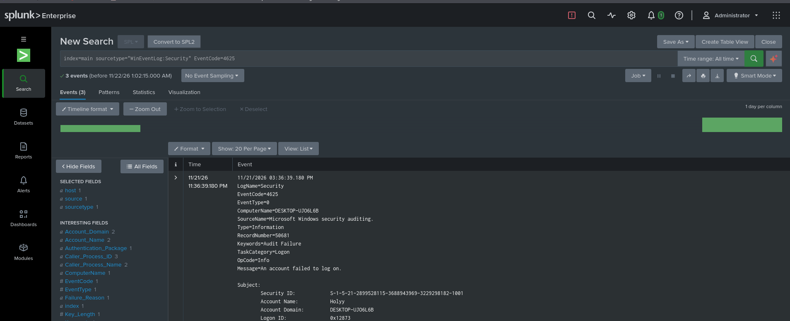
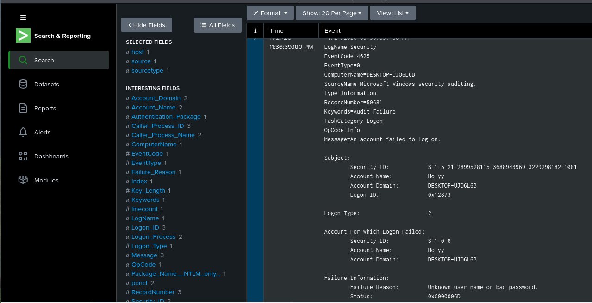
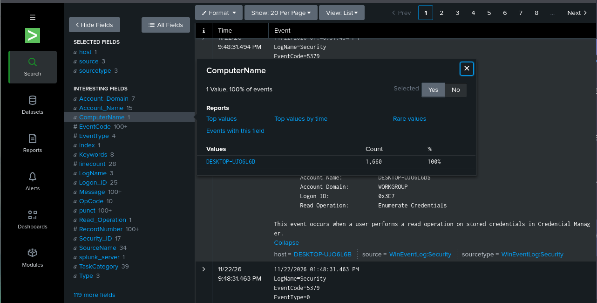

# Windows Event ID 4625 – Failed Logon Investigation

## 1. Investigation Objective

The objective of this investigation was to identify and examine failed Windows authentication attempts using Splunk Enterprise.

The investigation focused on Windows Security Event ID 4625 to understand the circumstances surrounding failed logon attempts, identify the affected account, examine authentication failure details, and determine whether the observed activity was consistent with legitimate user error or potentially suspicious behaviour.

## 2. Lab Environment

| Component | Description |
|---|---|
| SIEM Platform | Splunk Enterprise 10.6.2.5 |
| Endpoint | Windows 10 Pro (FLARE-VM) |
| Log Forwarder | Splunk Universal Forwarder 10.6.2.5 |
| Analysis System | Kali Linux |
| Virtualisation | Oracle VirtualBox |
| Log Source | Windows Security Event Log |

## 3. Investigation and SPL Query

The investigation was conducted using Splunk Search & Reporting to examine Windows Security Event Logs collected from the Windows 10 endpoint through Splunk Universal Forwarder.

The following SPL query was used to identify failed logon attempts:

```spl
index=main sourcetype="WinEventLog:Security" EventCode=4625
```

## 4. Query Breakdown

- `index=main`: Searches the main Splunk index.
- `sourcetype="WinEventLog:Security"`: Restricts the search to Windows Security Event Log records.
- `EventCode=4625`: Returns events associated with failed account logons.

## 5. Investigation Findings

The Splunk search returned three Windows Security events matching Event ID 4625.

The following details were observed:

| Field | Observed Value |
|---|---|
| Event ID | 4625 |
| Account Name | Holly |
| Account Domain | DESKTOP-UJO6L6B |
| Logon Type | 2 |
| Failure Reason | Unknown user name or bad password |
| Status | 0xC000006D |
| Matching Events | 3 |

### Findings Interpretation

Windows Security Event ID 4625 is generated when an account logon attempt fails.

The observed Logon Type 2 indicates an interactive logon attempt, while the failure reason and status code indicate a logon failure associated with invalid credentials.

Status code 0xC000006D represents a general logon failure associated with invalid logon credentials.

## 6. Screenshots and Evidence

The following screenshots provide visual evidence of the investigation performed in Splunk Enterprise.

### 6.1 Failed Logon Search Results

The screenshot below shows the Splunk search used to identify Windows Security Event ID 4625.



### 6.2 Failed Logon Event Details

The screenshot below displays the details of an individual failed logon event, including the account name, logon type, failure reason, and status code.



### 6.3 Windows Computer Information

The screenshot below provides the Windows computer-name information associated with the endpoint used in the investigation.



## 7. Cause Assessment

The three failed logon events were consistent with an incorrect password entered during the Windows configuration process.

At the time of the investigation, no other Windows VM activity had been performed that would explain these events. Based on the sequence of events and the observed failure reason (`Unknown user name or bad password`), the failed logons were attributed to the earlier password-entry mistake.

## 8. Security Analyst's Observation

Although repeated failed logons can indicate suspicious authentication activity, the surrounding lab context is important when interpreting these events. In this instance, the available evidence and activity timeline supported a legitimate configuration-related explanation rather than an indication of a brute-force attack.

## 9. Conclusion

This investigation demonstrated how Splunk Enterprise can be used to identify and examine failed Windows authentication attempts through Security Event Logs.

Using SPL, three Event ID 4625 records were identified and examined. Analysis of the account information, logon type, failure reason, and status code provided insight into the authentication failures.

Based on the lab activity timeline, the events were attributed to an incorrect password entered during Windows configuration.

This exercise reinforced the importance of analysing authentication events in context rather than treating every failed logon as malicious activity.