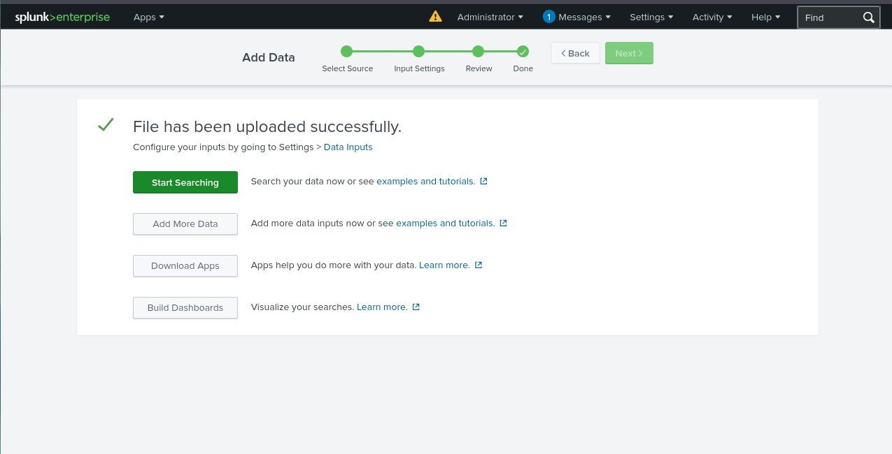
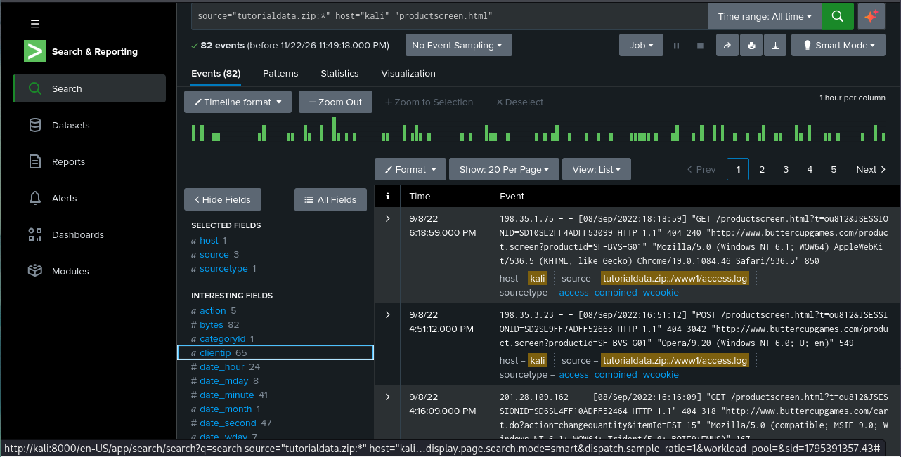
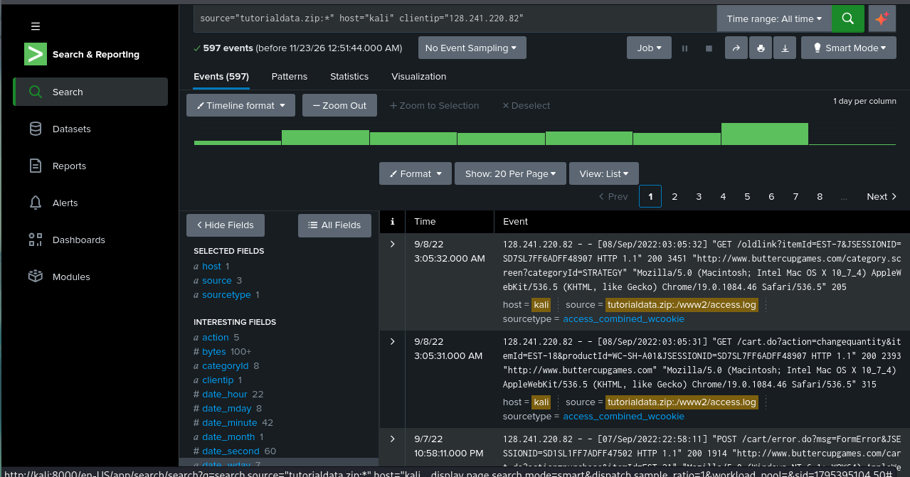
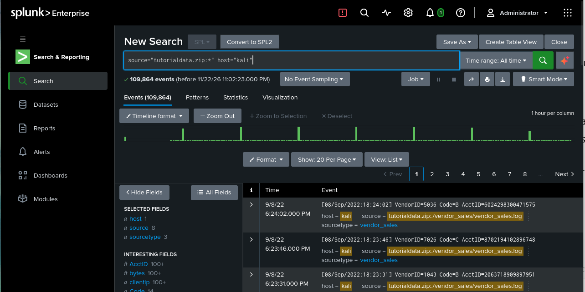

# Web Log Analysis Using Splunk

## 1. Investigation Objective

The objective of this exercise was to practise analysing web server logs using Splunk Enterprise.

The investigation involved searching an uploaded tutorial dataset, identifying client IP addresses requesting a specific web resource, and examining the URL paths requested by an individual client IP address.

The exercise focused on developing practical skills in log filtering, field analysis, HTTP request investigation, and identifying potentially interesting web activity.

## 2. Lab Environment

| Component | Description |
|---|---|
| SIEM Platform | Splunk Enterprise 10.6.2.5 |
| Analysis System | Kali Linux |
| Dataset | LetsDefend tutorial data |
| Data Source | `tutorialdata.zip` |
| Search Interface | Splunk Search & Reporting |
| Search Language | Splunk Processing Language (SPL) |

## 3. Investigation 1: Product Screen Requests

The first investigation focused on identifying web requests made to the `/productscreen.html` resource within the uploaded LetsDefend tutorial dataset.

The following SPL query was used:

```spl
source="tutorialdata.zip:*" host="kali" "/productscreen.html"
```

### Query Breakdown

- `source="tutorialdata.zip:*"`: Filters events based on their source within the uploaded tutorial dataset.
- `host="kali"`: Restricts the search to events associated with the Kali host.
- `"/productscreen.html"`: Searches for events containing the specified URL path.

## 4. Investigation Findings

The SPL search returned 164 events containing requests to `/productscreen.html` from the uploaded LetsDefend tutorial dataset.

Using Splunk's field analysis functionality, the `clientip` field revealed 65 distinct client IP addresses associated with the matching events.

### Findings Summary

| Metric | Result |
|---|---:|
| Matching Events | 164 |
| Distinct Client IP Addresses | 65 |

### Findings Interpretation

The results demonstrate that multiple client IP addresses accessed the requested web resource, with some IP addresses generating multiple requests.

Examining the distribution of client IP addresses helps an analyst understand the sources of web requests and identify clients that may warrant further investigation.

### Data Quality Observation

During the exercise, the initial search returned 82 matching events. After the tutorial dataset was uploaded again, a subsequent search returned 164 matching events.

The increase suggests that the dataset may have been ingested more than once. This possibility was not independently verified during the investigation and is recorded as a data-quality observation.


## 5. Investigation 2: Client IP Activity Analysis

The second investigation focused on examining the web activity associated with client IP address `128.241.220.82`.

The following SPL query was used:

```spl
source="tutorialdata.zip:*" host="kali" clientip="128.241.220.82"
```

### Query Breakdown

- `source="tutorialdata.zip:*"`: Searches the uploaded tutorial dataset.
- `host="kali"`: Restricts results to events associated with the Kali host.
- `clientip="128.241.220.82"`: Filters the results to requests associated with the specified client IP.

### Findings

The `uri_path` field displayed one distinct URL path across six matching events.

| Field | Observed Value |
|---|---|
| Client IP | 128.241.220.82 |
| URI Path | `/productscreen.html` |
| Matching Requests | 6 |
| Distinct URI Paths | 1 |

### Findings Interpretation

All six matching events were associated with requests to `/productscreen.html`.

The event records included both GET and POST HTTP methods. Further investigation would be required to determine the purpose and significance of these requests.

## 6. Screenshots and Evidence

The following screenshots provide visual evidence of the web-log analysis performed using Splunk Enterprise and the LetsDefend tutorial dataset.

### 6.1 Tutorial Dataset Upload

This screenshot shows the successful upload of the tutorial dataset into Splunk.



### 6.2 Product Screen Request Search

This screenshot shows the SPL search used to identify requests containing `/productscreen.html`.



### 6.3 Client IP Investigation

This screenshot shows the investigation of web activity associated with client IP `128.241.220.82`.



### 6.4 Tutorial Dataset Search Results

This screenshot provides evidence of the uploaded tutorial dataset and its search results.



## 7. Conclusion

This exercise demonstrated how Splunk Enterprise can be used to analyse web server logs and investigate client activity.

The investigation identified 164 matching events associated with requests to `/productscreen.html` and 65 distinct client IP addresses.

A second investigation focused on client IP `128.241.220.82`. The results showed six matching requests, all associated with the URI path `/productscreen.html`.

The event records included both GET and POST HTTP methods.

This exercise strengthened practical skills in SPL searching, field analysis, IP-based investigation, HTTP request analysis, and interpreting web server logs.

The findings also reinforced the importance of examining activity patterns and gathering additional context before classifying web traffic as malicious.